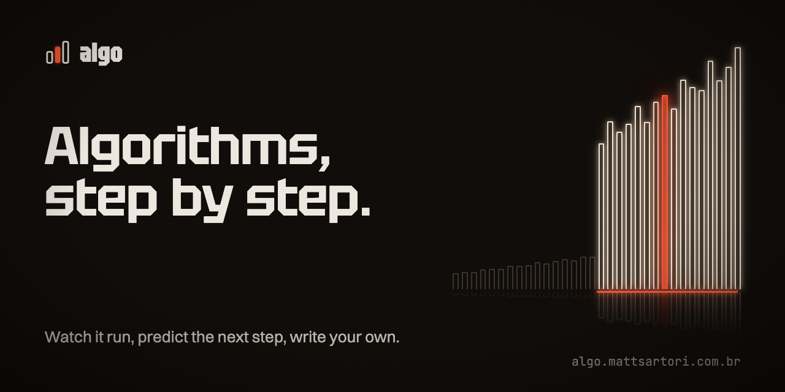

<p align="center">
  
</p>

<p align="center">
  <a href="https://github.com/matheussartori/algo/actions/workflows/ci.yml"></a>
  <a href="LICENSE"></a>
  <a href="https://creativecommons.org/licenses/by/4.0/"></a>
</p>

<p align="center">
  <a href="https://algo.mattsartori.com.br">Website</a> ·
  <a href="README.pt-BR.md">Português</a> ·
  <a href="CONTRIBUTING.md">Contributing</a>
</p>

---

**algo** teaches algorithms and data structures by running them. Every topic pairs a short explanation with a step-by-step player, a **Predict** mode that asks you for the next move before showing it, exercises whose tests run in your browser, and review questions. The content is in Brazilian Portuguese and English. The code is in TypeScript and JavaScript.

## Features

- **Step-by-step player.** Each algorithm is written once as a generator. The player, the highlighted source line and the variable panel all read from that same trace.
- **Predict mode.** Click the cell you think the algorithm will touch next. You get feedback on each step and a running score.
- **Exercises in the browser.** Write the solution in TypeScript or JavaScript. Visible and hidden tests run in a Web Worker with a timeout. Some exercises cap array reads to enforce O(log n).
- **Two languages.** pt-BR is the root locale and English lives under `/en/`.
- **WebGPU landing.** A particle swarm forms arrays, trees and growth curves as you scroll. Without WebGPU the page still works fully in plain CSS. The animation respects `prefers-reduced-motion`.
- **Static and private.** There are no accounts and no analytics. Exercise drafts stay in `localStorage`.

## Quick start

Requires Node 22+.

```sh
git clone https://github.com/matheussartori/algo.git
cd algo
npm install
npm run dev        # http://localhost:4321
```

| Script | What it does |
| --- | --- |
| `npm run dev` | Dev server with hot reload |
| `npm test` | Vitest: algorithms, exercises and the code runner |
| `npm run check` | `astro check` (types and templates) |
| `npm run build` | Static site in `dist/`, including the sitemap |
| `npm run preview` | Serves the build locally |
| `npm run brand` | Re-renders OG images, icons, favicon and this banner (needs Google Chrome) |

## Stack

[Astro](https://astro.build) and [Starlight](https://starlight.astro.build) for the docs, React islands for the player and the exercises, CodeMirror for the editor, and [sucrase](https://github.com/alangpierce/sucrase) to transpile TypeScript in the worker. [GSAP](https://gsap.com) and [Lenis](https://lenis.dev) handle motion on the landing, and [vgpu](https://www.npmjs.com/package/vgpu) with WGSL shaders draws the background.

## How it is organised

| Path | Contents |
| --- | --- |
| `src/algorithms/` | Each algorithm is an `AlgorithmDef`. `steps` is a generator that emits `Step`s for the player, and `run` is the plain version the tests compare the trace against. |
| `src/exercises/` | Exercise definitions: starter and solution in TS (JS is derived), visible and hidden tests, and hints in both languages. |
| `src/lib/runner/` | The code runner. `core.ts` is pure: it transpiles and runs the tests. `worker.ts` and `client.ts` spawn a fresh Web Worker per run, with a 3s timeout. |
| `src/components/` | MDX components (`AlgoPlayer`, `Practice`, `Quiz`), the React islands, the full-screen solve screen (`solve/`) and the landing page. |
| `src/game/` | The exercise stage: `engine.ts` turns the indexes the learner's code read into beats, and `scenes/` draws them. |
| `src/gfx/stage/` | The WebGPU background: particle simulation (`sim.wgsl`), trail, bloom and composite. |
| `src/content/docs/` | The lessons. The root is pt-BR and `en/` is English. |
| `src/styles/` | Design tokens (`tokens.css`) and the Starlight theme. |
| `scripts/brand/` | HTML sources for the brand images, rendered with headless Chrome. |

### Add an algorithm

1. Create `src/algorithms/<topic>/<name>.ts` exporting an `AlgorithmDef`, and register it in `src/algorithms/index.ts`.
2. Use it in MDX: `<AlgoPlayer algo="<id>" input={{ ... }} />`. Add `predict` to open in Predict mode.
3. `npm test` checks that every referenced line exists and that the trace matches `run`.

### Add an exercise

Each lesson has a ladder of five exercises, each solved on its own full-screen page (`/solve/<id>/`). The `algo-exercise` skill in `.claude/skills/` has the full recipe (story, themes, tests, scene).

1. Add an `ExerciseDef` in `src/exercises/` with its `lesson` and `order` (1 to 5). The tests make sure the solution passes, the starter fails and the story stays short.
2. Add it to the lesson's `exercises([...])` group in `astro.config.mjs`. The lesson's `<Practice lesson="..." />` and the solve screen pick it up on their own.

## Deploying

The build is a static site, so any static host works (Vercel, Netlify, Cloudflare Pages, GitHub Pages). The production domain is set in `src/lib/head.mjs` (`SITE`). The sitemap, canonical URLs and OpenGraph tags all derive from it.

## Contributing

Corrections, new topics, translations and bug reports are all welcome. Read [CONTRIBUTING.md](CONTRIBUTING.md) before opening a pull request, and follow the [Code of Conduct](CODE_OF_CONDUCT.md). Please report security issues privately, as described in [SECURITY.md](SECURITY.md).

## License

The code is under the [MIT License](LICENSE). Lessons, exercises and images are under [CC BY 4.0](https://creativecommons.org/licenses/by/4.0/). See the [terms of use](https://algo.mattsartori.com.br/en/terms/) for details.
