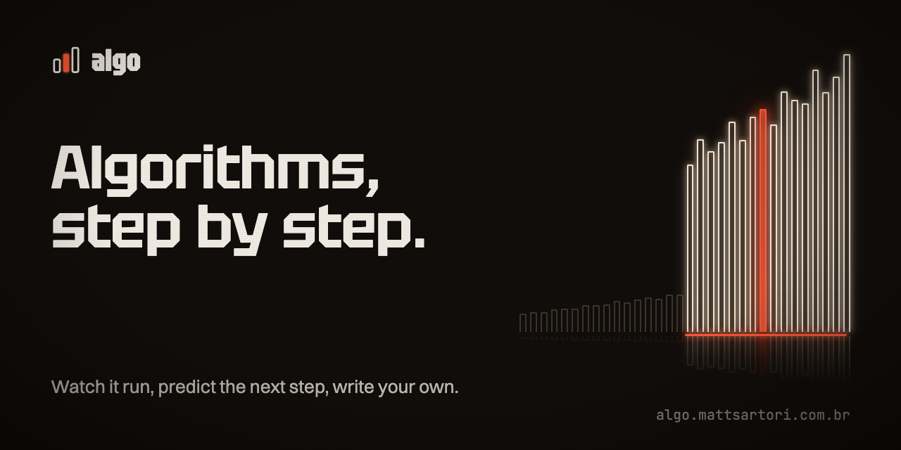

<p align="center">
  
</p>

<p align="center">
  <a href="https://algo.mattsartori.com.br">Site</a> ·
  <a href="README.md">English</a> ·
  <a href="CONTRIBUTING.md">Como contribuir</a>
</p>

---

O **algo** ensina algoritmos e estruturas de dados rodando cada um deles. Cada tópico junta:

- uma explicação curta;
- um player passo a passo;
- o modo **Prever**, que pede o próximo passo antes de mostrá-lo;
- exercícios com testes rodando no navegador;
- perguntas de revisão.

Conteúdo em português e inglês, código em TypeScript e JavaScript.

## Recursos

- **Player passo a passo.** Cada algoritmo é escrito uma vez, como generator. O player, a linha destacada e o painel de variáveis leem do mesmo trace.
- **Modo Prever.** Clique no índice que o algoritmo vai examinar. Cada passo dá retorno e o placar acompanha.
- **Exercícios no navegador.** TypeScript ou JavaScript, com testes visíveis e ocultos num Web Worker com timeout. Alguns limitam leituras no array para exigir O(log n).
- **Dois idiomas.** pt-BR na raiz e inglês em `/en/`.
- **Landing em WebGPU.** Um enxame de partículas forma arrays, árvores e curvas conforme você rola. Sem WebGPU a página funciona inteira em CSS. A landing respeita `prefers-reduced-motion`.
- **Estático e privado.** Sem contas e sem analytics. Os rascunhos ficam no `localStorage`.

## Rodando

Precisa de Node 22+.

```sh
git clone https://github.com/matheussartori/algo.git
cd algo
npm install
npm run dev        # http://localhost:4321
```

| Script | O que faz |
| --- | --- |
| `npm run dev` | Servidor de desenvolvimento |
| `npm test` | Vitest: algoritmos, exercícios e runner |
| `npm run check` | `astro check` (tipos) |
| `npm run build` | Site estático em `dist/`, com sitemap |
| `npm run preview` | Serve o build localmente |
| `npm run brand` | Regera imagens OG, ícones, favicon e este banner (precisa do Google Chrome) |

## Organização

| Pasta | O que tem |
| --- | --- |
| `src/algorithms/` | Cada algoritmo é um `AlgorithmDef`. `steps` é um generator que emite `Step`s para o player. `run` é a versão simples que os testes comparam com o trace. |
| `src/exercises/` | Exercícios: starter e solução em TS (o JS é derivado), testes visíveis e ocultos, dicas nos dois idiomas. |
| `src/lib/runner/` | Executor. `core.ts` é puro: transpila e roda os testes. `worker.ts` e `client.ts` criam um Web Worker novo por execução, com timeout de 3s. |
| `src/components/` | Componentes MDX (`AlgoPlayer`, `Exercise`, `Quiz`), as ilhas React e a landing. |
| `src/gfx/stage/` | Fundo em WebGPU: partículas (`sim.wgsl`), rastro, bloom e composição. |
| `src/content/docs/` | As lições. A raiz é pt-BR e `en/` é inglês. |
| `scripts/brand/` | Fontes HTML das imagens da marca, renderizadas com Chrome headless. |

### Adicionando um algoritmo

1. Crie `src/algorithms/<tema>/<nome>.ts` exportando um `AlgorithmDef` e registre em `src/algorithms/index.ts`.
2. Use no MDX: `<AlgoPlayer algo="<id>" input={{ ... }} />`. Acrescente `predict` para abrir no modo Prever.
3. `npm test` confere que as linhas existem e que o trace bate com `run`.

### Adicionando um exercício

1. Adicione um `ExerciseDef` em `src/exercises/`. O teste garante que a solução passa e o starter não.
2. Crie a página em `src/content/docs/.../<slug>.mdx`, e a versão em `en/`, com `<Exercise id="<id>" />`.

### Segurança

O código do aluno roda num Web Worker. Ele não tem acesso ao DOM, e um loop infinito é encerrado. **Isso não é um sandbox para código de terceiros.**

## Deploy

O build é estático e roda em qualquer host (Vercel, Netlify, Cloudflare Pages, GitHub Pages). O domínio fica em `src/lib/head.mjs` (`SITE`). Sitemap, canonical e OpenGraph saem dele.

## Licença

O código está sob a [MIT](LICENSE). Textos, exercícios e imagens estão sob a [CC BY 4.0](https://creativecommons.org/licenses/by/4.0/). Detalhes nos [termos de uso](https://algo.mattsartori.com.br/terms/).
